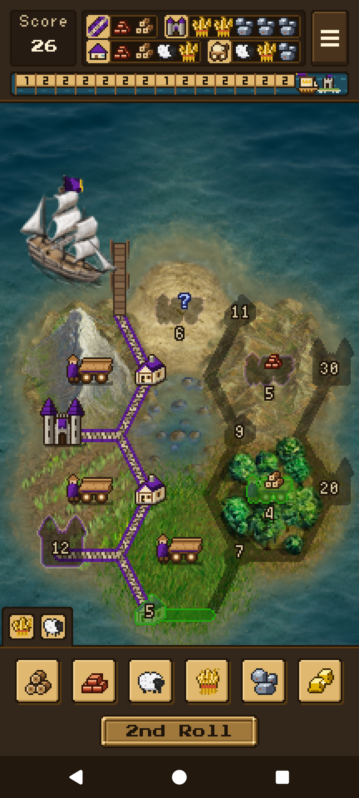
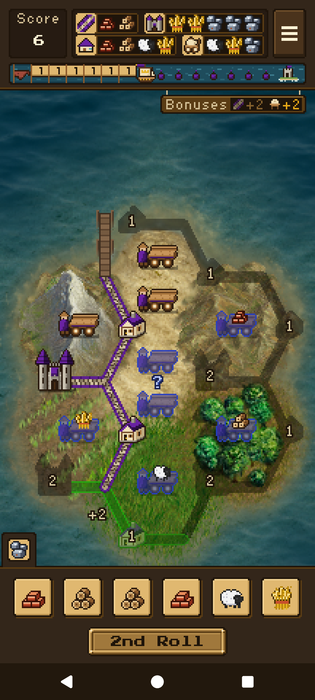

# Islewright: Roll

A solitaire dice game for Android: roll, then build roads, villages, castles and traders across a small island.

Each turn you get up to three rolls of six dice. Keep the dice you want, then spend them on the island: roads open up new sites, villages and castles score, and traders bank a resource for later. Tarnholm asks how high you can score in 15 turns, and Dunholm is a race to 10 points. It plays offline in seven languages, with no ads, accounts or tracking.

  
  

## Ongoing work

The next release is a port to Rust and [Day](https://daybrite.dev), for publication through the
[App Fair](https://appfair.org) on iPhone and Android. The plan and its current state are in the
[App Fair epic](https://github.com/islewright-roll/islewright/issues/8). The port is very early
and lives on the [`feature/day-port`](https://github.com/islewright-roll/islewright/tree/feature/day-port)
branch, in `Islewright/`. The Java app in this branch is the game that ships today.

To help, pick an open item from the epic and work on a feature branch. Port work branches from
`feature/day-port` and targets it; everything else targets `dev`.

## Project History

It began as Resource Dice Game by Ridgeline Apps (2012), whose source is kept at the [original repository](https://code.google.com/archive/p/android-dice-game/). Its code comes from version 1.15 by Marcus Hoffmann (Bubu), who moved the project to Gradle and returned it to F-Droid in 2017 (https://git.bubu1.eu/Bubu/android-dice-game), with a German translation by tmaex. Hellmark preserved the Google Code archive and the F-Droid 1.15 release (https://github.com/Hellmark/android-dice-game).

Full credits are in CREDITS.md.

## Regenerating the art

All of the art in `app/src/main/res/drawable-nodpi/` is generated by three scripts and
committed, so a normal build needs none of this. To regenerate it you need Python 3 with
Pillow and, for the island, a checkout of The Battle for Wesnoth (`WESNOTH_DIR`):

    python3 -I tools/bake_board.py
    python3 -I tools/make_ui.py
    python3 -I tools/bake_font.py

See `tools/README.md` for what each one does and `CREDITS.md` for the licences.

## Building

Debug build, which is all you need to run it on an emulator:

    ./gradlew :app:assembleDebug

### Signed release build

Release builds are signed with a key supplied through the environment, so no keystore or
password is ever in the repository. The build reads `ANDROID_KEYSTORE` (the path to a
PKCS12 keystore), `ANDROID_KEYSTORE_PASSWORD` and, optionally, `ANDROID_KEY_ALIAS`
(default `islewright`). With none of them set, the release build is simply unsigned:

    ANDROID_KEYSTORE=/path/to/key.p12 ANDROID_KEYSTORE_PASSWORD=... ./gradlew :app:assembleRelease

