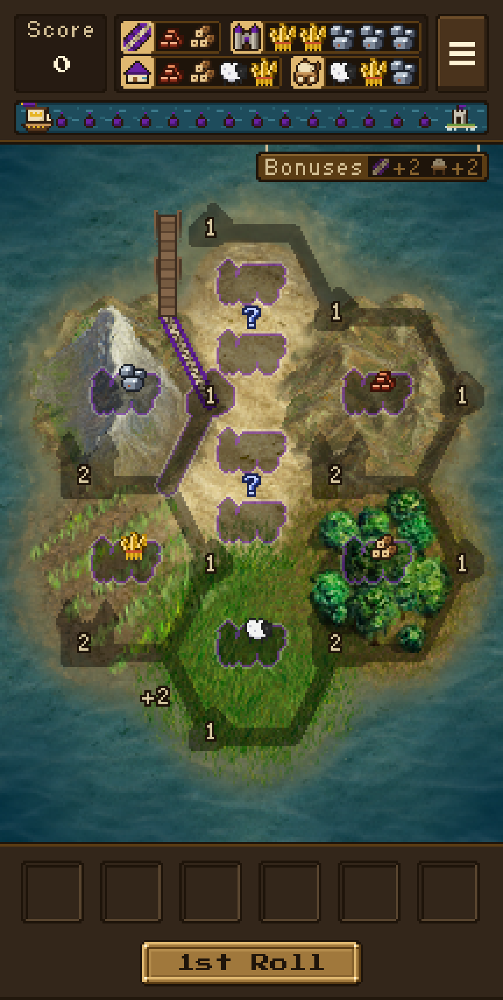
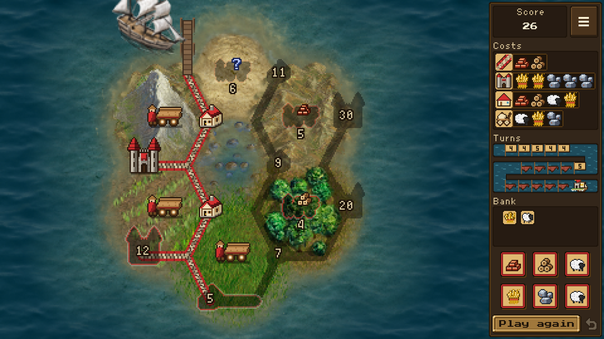

# Islewright: Roll

A solitaire dice game: roll, then build roads, villages, castles and traders across a small
island. One Rust codebase, built with [Day](https://daybrite.dev), runs it on iPhone, Android and
the web.

It is free, with no ads, no in-app purchases, no tracking and no account, and it works offline.
See [PRIVACY.md](PRIVACY.md).

<p>
  
  
</p>

## Where things stand

The latest release is [2.0.0](https://github.com/Islewright-Roll/Islewright-Roll/releases/tag/v2.0.0),
the Java app for Android; its code is on the `prod` branch. The `dev` branch holds its successor,
this Rust rewrite, which is being prepared for publication through the [App Fair](https://appfair.org).
The plan and its current state are in the
[App Fair epic](https://github.com/Islewright-Roll/Islewright-Roll/issues/8).

To help, pick an open item from the epic, work on a feature branch, and open your pull request
against `dev`.

## Playing

Each turn you get three rolls. Tap dice to keep them, roll the rest, then build whatever your
resources pay for. Roads open up sites for villages and castles; two gold stand in for any one
resource; traders bank a resource for a later turn.

- **Tarnholm**: fifteen turns around a lake. Score as much as you can before the King's ship
  reaches the pier.
- **Dunholm**: a race to ten points in as few turns as you can.

A phone keeps the game upright. A tablet on its side, or a wide window on a computer, shows the
island in open sea beside one panel holding the score, the costs, the turns, the bank and the dice.

With a keyboard: 1 to 6 keep or release a die, 0 rolls, 9 builds the suggested spot, 7 undoes,
and 8 dismisses a tutorial tip. Where the platform passes letters to the game, R or Space also
rolls, B builds, U undoes, Enter dismisses a tip, and M or Escape opens the menu.

## Building

Install Rust with rustup, then the Day CLI, and check the toolchains:

```sh
cargo install --locked day-cli
day doctor
```

Then build and run a target:

```sh
day launch -t android-material   # an emulator or a device over adb
day launch -t web-dom            # serves the web build and opens a browser
day launch -t ios-uikit          # macOS with Xcode 27 or newer
```

`cargo test` runs the tests with Day's `mock` backend, and `day lint` checks the project, its
locales and the store listing. The App Fair builds the published identity with
`day --flavor appfair` (see `Day-appfair.toml`).

The game currently needs a few changes to Day that are not in a Day release yet. They are on the
`islewright` branch of [Islewright-Roll/day](https://github.com/Islewright-Roll/day/tree/islewright),
a fork of Day; build against a checkout of it with `day patch --local <checkout>`.

## Layout

- `src/rules/`: the game rules, scoring and saved state, independent of any UI.
- `src/view/`: the game screen, drawn into a pixel-art framebuffer.
- `src/app/`, `src/ui/`: the menu, pages, settings, sound and the pixel-art widget kit.
- `tests/`: the rules and layout tests.
- `resource/assets/`: the board art, pieces, bitmap fonts, sound effects and rules text.
- `resource/locales/`: the UI strings, in English, French, German, Spanish, Indonesian, Italian
  and Brazilian Portuguese.
- `platform/`: the Android and iOS shells' settings.
- `store/storefront.toml`: the App Store and Google Play listing. `website/`: the project site.
- `dayscript/`: the walkthrough that tests the app and captures the store screenshots.
- `tools/`: the scripts that generate the art, fonts and sounds from their sources (see
  [tools/README.md](tools/README.md)), and the debug scenarios.
- `AGENTS.md`: notes for working on the code.

## Project history

It began as Resource Dice Game by Ridgeline Apps (2012), whose source is kept at the
[original repository](https://code.google.com/archive/p/android-dice-game/). Version 1.15 by Marcus
Hoffmann (Bubu), who moved the project to Gradle and returned it to F-Droid in 2017
(<https://git.bubu1.eu/Bubu/android-dice-game>), with a German translation by tmaex, is where this
repository's code begins. Hellmark preserved the Google Code archive and the F-Droid 1.15 release
(<https://github.com/Hellmark/android-dice-game>). Islewright Team carried the Java app to 2.0 and
then rewrote it in Rust.

## Credits and license

Islewright: Roll is free software under the GNU General Public License, version 3 or later; see
[LICENSE.md](LICENSE.md).

The island terrain, the King's ship and some sound effects come from The Battle for Wesnoth
under the GNU GPL; the fonts are under the SIL Open Font License; other sounds are CC0 or
CC BY-SA 4.0. [CREDITS.md](CREDITS.md) lists every source, author and license, and
[DEPENDENCIES.md](DEPENDENCIES.md) every crate the app links.

## Legal notice

Islewright is not affiliated with or endorsed by Catan GmbH. CATAN® is a registered trademark of Catan GmbH.
